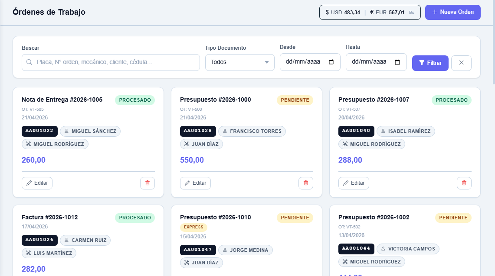
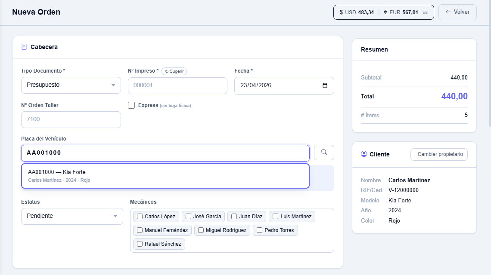
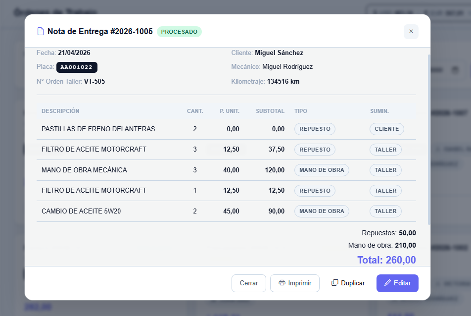
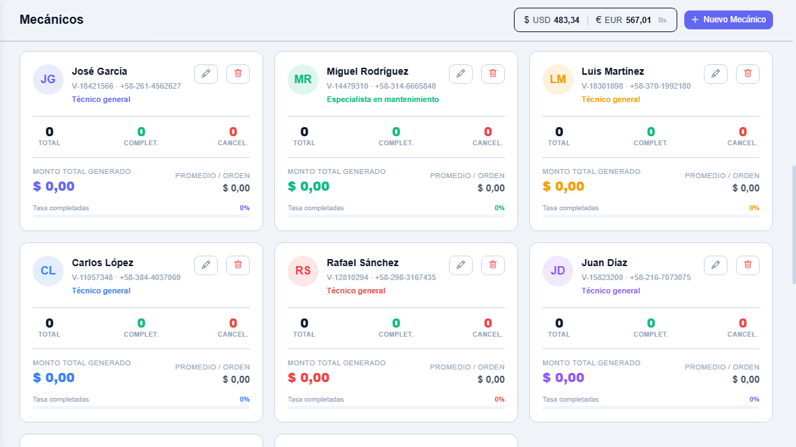

## 01. Contexto de Negocio & Deuda Técnica Legada

**Auto Servicios Villalobos, C.A.** acumuló más de 8 años de operaciones críticas en una decena de hojas de cálculo de Excel inconexas (+7.000 registros). Al alcanzar ese volumen, las rotaciones de dueños, colisiones documentales y límites físicos colapsaron la gestión, motivando una reingeniería integral:

<div class="grid grid-cols-1 md:grid-cols-2 gap-4 my-6">
  <div class="rounded-xl border border-white/10 bg-white/[0.02] p-4 space-y-2">
    <div class="flex items-center justify-between">
      <span class="text-xs font-semibold text-white">Rotación de Propietarios</span>
      <span class="text-[10px] font-mono px-2 py-0.5 rounded bg-emerald-500/10 text-emerald-400 border border-emerald-500/20">Snapshot Inmutable</span>
    </div>
    <div class="text-xs text-neutral-400 leading-relaxed !my-0">
      Al transferir una placa a un nuevo cliente en Excel, se sobreescribían facturas pasadas. Se introdujo congelación de datos fiscales al emitir la orden para blindar la trazabilidad legal.
    </div>
  </div>

<div class="rounded-xl border border-white/10 bg-white/[0.02] p-4 space-y-2">
  <div class="flex items-center justify-between">
    <span class="text-xs font-semibold text-white">
      Doble Numeración Operativa
    </span>
    <span class="text-[10px] font-mono px-2 py-0.5 rounded bg-sky-500/10 text-sky-400 border border-sky-500/20">
      Bahía vs Fiscal
    </span>
  </div>
  <div class="text-xs text-neutral-400 leading-relaxed !my-0">
    Coexistencia entre boletas internas numeradas en foso por mecánicos y
    correlativos tributarios formales. El sistema desacopló ambas secuencias
    permitiendo servicios express inmediatos.
  </div>
</div>

<div class="rounded-xl border border-white/10 bg-white/[0.02] p-4 space-y-2">
  <div class="flex items-center justify-between">
    <span class="text-xs font-semibold text-white">Papelería Continua</span>
    <span class="text-[10px] font-mono px-2 py-0.5 rounded bg-amber-500/10 text-amber-400 border border-amber-500/20">
      Papelería 10/12 Renglones
    </span>
  </div>
  <div class="text-xs text-neutral-400 leading-relaxed !my-0">
    Formatos preimpresos con límite físico rígido (10 renglones en Facturas, 12
    en Notas). Se implementó particionamiento automático multipágina con reserva
    atómica de correlativos consecutivos.
  </div>
</div>

  <div class="rounded-xl border border-white/10 bg-white/[0.02] p-4 space-y-2">
    <div class="flex items-center justify-between">
      <span class="text-xs font-semibold text-white">Deuda Técnica Legacy</span>
      <span class="text-[10px] font-mono px-2 py-0.5 rounded bg-purple-500/10 text-purple-400 border border-purple-500/20">Datastore Híbrido</span>
    </div>
    <div class="text-xs text-neutral-400 leading-relaxed !my-0">
      Ingestión ETL de +7.000 registros heredados de Excel sin normalización destructiva: almacén frío JSON (<code class="text-xs">historico_reconstruido</code>) para consulta histórica y base 3NF para transacciones en caliente.
    </div>
  </div>
</div>

El entorno exigió además fijación de costos en USD con facturación y cobro en VES según la tasa oficial del Banco Central de Venezuela (BCV), sincronizada de forma desatendida mediante scraping resiliente en caliente.

---

## 02. Interfaz en Producción & Flujo Operativo

La interfaz se concibió bajo la premisa de un **Monolito SSR Ligero**: plantillas Jinja2 y componentes reactivos en **Vanilla JavaScript ES6+**, sin compiladores ni empaquetadores externos, con renderizado veloz y soporte nativo para impresión continua `@media print`.

### 1. Cuadrícula Reactiva de Órdenes y Búsqueda Operativa

Búsqueda reactiva en tiempo real sobre miles de registros mediante filtrado instantáneo por placa y estatus.


_Cuadrícula operativa: filtrado reactivo por placa y estatus en tiempo real (< 35 ms) con actualización dinámica sin recarga de página._

---

### 2. Módulo de Emisión Transaccional con Particionamiento Atómico

Formulario ergonómico con autocompletado en caliente, sincronización cambiaria BCV y división automática de hojas fiscales.


_Módulo de emisión: captura de servicios, cálculo bimoneda en divisa y bolívares, y particionamiento automático con create_split._

---

### 3. Inspección Detallada de Orden y Snapshots Inmutables

Modal de inspección integral con congelación de titularidad de cliente/vehículo y rutinas de impresión continua milimétrica.


_Detalle expandido de orden: visualización de snapshots inmutables de cliente y vehículo para auditoría y despacho a papel continuo._

---

### 4. Dashboard Analítico de Rendimiento Laboral

Panel gerencial con agregaciones SQL nativas para auditoría de mano de obra y repuestos discriminados por técnico.


_Dashboard de productividad laboral: cálculo consolidado de órdenes ejecutadas y montos por mecánico computado en base de datos en menos de 20 ms._

---

## 03. Arquitectura del Sistema: Monolito Híbrido SSR + API REST

La plataforma implementa el **Service Layer Pattern** para aislar estrictamente las reglas transaccionales de la capa de transporte HTTP y presentación:

<CodeWindow title="architecture_overview.txt">

```text
┌─────────────────────────────────────────────────────────────────────────┐
│                           NAVEGADOR / CLIENTE                           │
│        (HTML5 Semántico, CSS3 @media print, Vanilla JavaScript ES6+)     │
└────────────────────────────────────┬────────────────────────────────────┘
                                     │ HTTP / JSON / SSR
┌────────────────────────────────────▼────────────────────────────────────┐
│                       CAPA DE CONTROLADORES API                         │
│               FastAPI 0.136 (v2.0) / Flask-WSGI (cPanel)                │
│       Rutas: /api/clientes, /api/vehiculos, /api/ordenes, /api/mecanicos │
│                 Validaciones en frontera con Pydantic v2                │
└────────────────────────────────────┬────────────────────────────────────┘
                                     │
┌────────────────────────────────────▼────────────────────────────────────┐
│                         CAPA DE SERVICIOS (DDD)                         │
│   cliente_service  │  vehiculo_service  │  orden_service  │  tasa_service  │
│      - Lógica transaccional pura                                        │
│      - Particionamiento create_split y bloqueo pesimista                │
│      - Construcción de snapshots inmutables                             │
└────────────────────────────────────┬────────────────────────────────────┘
                                     │
┌────────────────────────────────────▼────────────────────────────────────┐
│                        PERSISTENCIA Y MODELADO                          │
│               SQLAlchemy 2.0 ORM (Declarative Base Mapped)              │
│       SQLite 3 (PRAGMA journal_mode=DELETE) ──► PostgreSQL Ready        │
└─────────────────────────────────────────────────────────────────────────┘
```

</CodeWindow>

### Organización Modular en Cuatro Capas

1. **Routers (`app/routers/`):** Controladores delgados con inyección de dependencias (`Depends`) y validación de esquemas en frontera con **Pydantic v2**.
2. **Servicios de Dominio (`app/services/`):** Lógica transaccional pura (`create_split`, snapshots inmutables) encapsulando operaciones atómicas `db.commit()` y `db.rollback()`.
3. **Presentación SSR (`templates/` y `static/js/`):** Jinja2 para renderizado inicial sin dependencias de empaquetado e interacciones reactivas con Vanilla JavaScript.
4. **Persistencia (`app/models/`):** Modelos declarativos en SQLAlchemy 2.0 (`Mapped[...]`), compatibles con SQLite local y escalables a PostgreSQL.

### Adaptación Pragmática: De cPanel WSGI a FastAPI

Para operar de inmediato sin sobrecostos de hosting, la plataforma se desplegó en **cPanel** mediante **Phusion Passenger** (estándar WSGI) sobre Flask, reutilizando modelos y plantillas. Posteriormente, el backend migró de forma natural hacia **FastAPI** bajo ASGI con **Uvicorn**, sumando inyección de dependencias desacoplada y contratos tipados.

---

## 04. Desafíos de Ingeniería & Casos Límite

El desarrollo resolvió fricciones críticas que abarcan desde la reactividad en el frontend del navegador hasta la consistencia transaccional en el motor relacional:

### Reto 1: Búsqueda Reactiva con Debounce (Vanilla JS ES6+)

En el patio operativo, las búsquedas continuas por placa, tipo o rango de fechas podían saturar el servidor con peticiones innecesarias en cada pulsación. Para garantizar una respuesta instantánea y fluida sin dependencias de frameworks ni librerías externas, se implementó una función de utilidad nativa con **debounce de 350 ms** y filtrado reactivo en Vanilla JS que actualiza dinámicamente el grid de órdenes:

<CodeWindow title="static/js/ordenes.js" githubUrl="https://github.com/Jesus-1205/Taller-Admin-v2/blob/master/static/js/ordenes.js">

```javascript
/**
 * static/js/ordenes.js & app.js
 * Búsqueda reactiva con debounce de 350 ms y renderizado dinámico sin frameworks.
 */

// Utilidad nativa de debounce en static/js/app.js
function debounce(fn, ms = 300) {
  let t;
  return (...args) => { clearTimeout(t); t = setTimeout(() => fn(...args), ms); };
}

// Escucha reactiva en el input de búsqueda de órdenes
if (document.getElementById('grid') && !document.getElementById('itemsBody')) {
  document.addEventListener('DOMContentLoaded', () => {
    loadOrdenes(1);
    checkHash();
    const d = debounce(() => loadOrdenes(1), 350);
    document.getElementById('fSearch')?.addEventListener('input', d);
  });
}

// Carga asíncrona parametrizada y refresco reactivo del grid
async function loadOrdenes(page = 1) {
  const params = new URLSearchParams({ page, limit: 25 });
  const s = document.getElementById('fSearch')?.value?.trim();
  const t = document.getElementById('fTipo')?.value;
  const d = document.getElementById('fDesde')?.value;
  const h = document.getElementById('fHasta')?.value;
  if (s) params.set('search', s);
  if (t) params.set('tipo_documento', t);
  if (d) params.set('fecha_desde', d);
  if (h) params.set('fecha_hasta', h);

  ordenesData = await GET('/api/ordenes/?' + params) || { items: [], total: 0, page: 1 };
  ordenesPage = page;
  renderOrdenesGrid();
  ordenesPagination();
}
```

</CodeWindow>

---

### Reto 2: Particionamiento Atómico por Límite de Papelería (`create_split`)

Los talonarios preimpresos disponen de cupos inalterables: 10 renglones útiles en Facturas y 12 en Notas de Entrega. Cuando una reparación sobrepasa dicho límite, `orden_service.create_split` calcula la partición necesaria (`chunks = ceil(total_items / limite_renglones)`) y adquiere un **bloqueo pesimista** sobre la secuencia para reservar correlativos continuos sin colisiones:

<CodeWindow title="app/services/orden_service.py" githubUrl="https://github.com/Jesus-1205/Taller-Admin-v2/blob/master/app/services/orden_service.py">

```python
def create_split(db: Session, data: schemas.OrdenCreate) -> list:
    """Crea una o varias órdenes según cuántos ítems quepan por hoja fiscal.
    
    Si los ítems sobran, crea N órdenes con correlativos consecutivos reservados
    atómicamente bajo bloqueo pesimista (.with_for_update()), cada una con su chunk
    de ítems, subtotal, e idénticos snapshots históricos.
    """
    limite = ITEMS_POR_HOJA.get(data.tipo_documento)
    detalles = data.detalles

    if not limite or len(detalles) <= limite:
        return [create(db, data)]

    # 1. División en chunks por límite físico de papelería
    chunks = [detalles[i:i + limite] for i in range(0, len(detalles), limite)]
    n_chunks = len(chunks)

    # 2. Reserva atómica de N correlativos consecutivos con bloqueo pesimista
    seq = (
        db.query(models.DocumentSequence)
        .filter(models.DocumentSequence.tipo_documento == data.tipo_documento)
        .with_for_update()
        .first()
    )

    if seq:
        m = re.search(r'\d+', str(data.numero_impreso).replace('-', '').replace(' ', ''))
        base_num = int(m.group()) if m else seq.ultimo_numero + 1
        base_num = max(base_num, seq.ultimo_numero + 1)

        numeros = [_formatear_numero(seq, base_num + i) for i in range(n_chunks)]
        seq.ultimo_numero = base_num + n_chunks - 1  # Bloque consecutivo garantizado
    else:
        m = re.search(r'\d+', str(data.numero_impreso).replace('-', '').replace(' ', ''))
        base_num = int(m.group()) if m else 1
        numeros = [str(base_num + i).zfill(6) for i in range(n_chunks)]

    # 3. Snapshot inmutable del cliente/vehículo al emitir
    dump_base = data.model_dump(exclude={"detalles", "total_orden", "mecanico_ids", "numero_impreso"})
    snap = _build_snapshot(db, data.placa_vehiculo)
    dump_base.update(snap)
```

</CodeWindow>

Toda la emisión se confina a un único bloque transaccional: o se imprimen todos los correlativos consecutivos con reserva atómica, o se revierte la operación por completo (`db.rollback()`), garantizando cero huecos fiscales.

---

### Reto 3: El Patrón Snapshot Histórico (Desnormalización Deliberada vs. 3NF)

En un modelado relacional 3NF académico, una orden de servicio no almacena el nombre del cliente ni los datos del vehículo; navega mediante claves foráneas `Orden.placa_vehiculo -> Vehiculo.id_cliente -> Cliente`.

Sin embargo, en el mundo real de un taller automotriz, los vehículos cambian de propietario con frecuencia. Si el sistema dependiera exclusivamente de la relación 3NF viva, **al transferir un vehículo a un nuevo titular se sobreescribirían retroactivamente todas las facturas y órdenes de trabajo emitidas años atrás**, invalidando la contabilidad histórica y violando las exigencias tributarias del SENIAT.

Para garantizar la inmutabilidad legal sin renunciar a la normalización para operaciones cotidianas, se implementó una **desnormalización intencional**: al emitir la orden en `orden_service.py`, se capturan y congelan en columnas dedicadas (`cli_nombre`, `cli_rif`, `veh_modelo`) los datos fiscales vigentes en ese instante exacto. El modelo ORM expone una propiedad híbrida con fallback transparente:

<CodeWindow title="app/models.py" githubUrl="https://github.com/Jesus-1205/Taller-Admin-v2/blob/master/app/models.py">

```python
class Orden(Base):
    __tablename__ = "ordenes"

    id_orden: Mapped[int] = mapped_column(Integer, primary_key=True, autoincrement=True)
    tipo_documento: Mapped[str] = mapped_column(Text, nullable=False)
    numero_impreso: Mapped[str] = mapped_column(Text, nullable=False)

    # ── Snapshot del cliente/vehículo al momento de crear la orden ──────────
    # Permite que si el vehículo cambia de dueño, las órdenes antiguas
    # conserven los datos del titular legal original (blindaje fiscal).
    cli_nombre: Mapped[str | None] = mapped_column(Text, nullable=True)
    cli_rif: Mapped[str | None] = mapped_column(Text, nullable=True)
    cli_telefono: Mapped[str | None] = mapped_column(Text, nullable=True)
    cli_direccion: Mapped[str | None] = mapped_column(Text, nullable=True)
    veh_modelo: Mapped[str | None] = mapped_column(Text, nullable=True)
    veh_anio: Mapped[str | None] = mapped_column(Text, nullable=True)
    veh_color: Mapped[str | None] = mapped_column(Text, nullable=True)

    vehiculo: Mapped["Vehiculo"] = relationship("Vehiculo", back_populates="ordenes")

    @property
    def cliente_nombre(self) -> str | None:
        # 1. Prioridad: Snapshot guardado en la orden (auditoría fiscal inmutable)
        if self.cli_nombre:
            return self.cli_nombre
        # 2. Respaldo: Datos vivos del cliente actual (compatibilidad registros legacy)
        if self.vehiculo and self.vehiculo.cliente:
            return self.vehiculo.cliente.razon_social
        return None

    @property
    def cliente_rif(self) -> str | None:
        if self.cli_rif:
            return self.cli_rif
        if self.vehiculo and self.vehiculo.cliente:
            return self.vehiculo.cliente.rif_cedula
        return None
```

</CodeWindow>

Esta decisión arquitectónica blinda la trazabilidad contable del taller: transferir una placa a un nuevo comprador solo afecta las reparaciones futuras, preservando el histórico legal intacto.

---

## 05. Estrategia de Testing & Calidad Relacional

La confiabilidad del motor transaccional se valida mediante un dataset de réplica de alta fidelidad y aserciones de consistencia relacional ejecutadas directamente en SQL:

### Dataset Sintético de Alta Fidelidad (`Taller_DB_TEST_2026.db`)

Para pruebas de regresión y verificación de márgenes sin exponer información sensible de clientes:

- **16 Clientes Sintéticos:** Conforme al formato de identificación fiscal del SENIAT.
- **48 Vehículos:** Variedad de marcas y modelos comerciales de alta rotación (Toyota, Chevrolet, Ford).
- **8 Mecánicos:** Distribución de especialidades técnicas (motor, tren delantero, frenos y electricidad).
- **83 Órdenes de Trabajo:** Cobertura de todos los estados del ciclo de vida (`Pendiente`, `En proceso`, `Procesado`, `Cancelado`).

### Aserciones Automatizadas de Consistencia Relacional

En lugar de suites complejas de integración, la salud del datastore se audita mediante una batería de aserciones SQL que verifican cuatro pilares críticos:

1. **Blindaje de Snapshots Inmutables:** Aserción estricta de que el 100% de las órdenes emitidas mantengan sus campos congelados (`cli_nombre IS NOT NULL`), verificando que ninguna orden histórica dependa de relaciones vivas mutables.
2. **Continuidad de Secuencia de Facturación:** Verificación de cero saltos o duplicados en los correlativos preimpresos (`ultimo_numero >= MAX(numero_impreso)`).
3. **Conciliación Matemática de Importes:** Comprobación de que la sumatoria de renglones coincida exactamente con la cabecera (`SUM(precio * cantidad) == total_orden`) con tolerancia `< 0.01` bajo control IEEE 754.
4. **Integridad Referencial y Huérfanos:** Verificación de cero renglones huérfanos en `ordenes_detalle` o asignaciones a identificadores inexistentes en `orden_mecanicos`.

### Casos Límite Críticos Auditados

- **Determinismo en Particionamiento:** Una orden con 24 ítems en formato Factura (límite 10) genera exactamente 3 documentos consecutivos continuos (10 + 10 + 4), con sumatoria idéntica al céntimo.
- **Transferencia de Titularidad:** La reasignación de propietario en el catálogo de vehículos no altera ninguna orden pasada, reflejando al nuevo comprador únicamente a partir de la siguiente emisión.
- **Resiliencia Cambiaria:** Si el portal del BCV presenta intermitencias, el servicio degrada con HTTP 503 controlado y habilita la tasa manual en la interfaz sin frenar la facturación física.

---

## 06. Conclusiones y Retrospectiva de Ingeniería

El desarrollo y puesta en producción de **Taller-Admin v2.0** consolidó lecciones fundamentales de ingeniería en entornos de negocio reales:

1. **Desnormalización Deliberada como Herramienta:** La pureza teórica de las formas normales (3NF) debe subordinarse a las exigencias legales del dominio. Los snapshots congelados son indispensables en software transaccional y tributario.
2. **Monolito Pragmático (YAGNI):** Jinja2 y Vanilla JS ES6+ resolvieron la operativa sin sobrecargas de frameworks SPA ni pipelines de compilación complejos, operando de forma ágil con menos de **80 MB de memoria RAM**.
3. **Respeto a las Restricciones Físicas:** El software debe adaptarse a la realidad operativa del cliente: papel continuo preimpreso de 10/12 renglones, impresoras fiscales de matriz de punto y terminales modestas.
4. **Rescate de Datos Legados:** El datastore híbrido salvó 8 años de historial operativo acumulado en Excel en un almacén frío JSON inmutable, sentando en simultáneo las bases de un núcleo relacional limpio para las transacciones del día a día.
