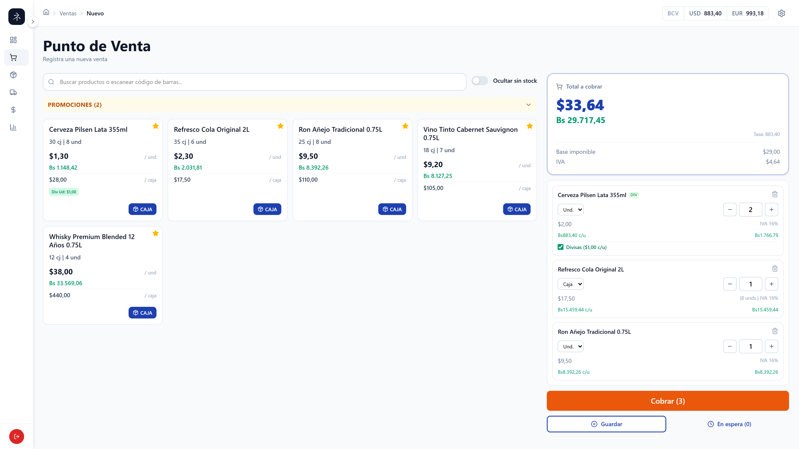

## 01. Contexto de Negocio & Fricción Operativa

**Yanesu Shisutemu** es una plataforma transaccional de Punto de Venta (POS) y ERP desarrollada a medida para el comercio minorista y mayorista general (gestión de productos, proveedores, compras, categorías, inventario multimoneda y analítica de ventas). Adicionalmente, incorpora módulos verticales especializados como el **control de envases retornables y casilleros** para licorerías y distribuidores de bebidas.

El sistema fue concebido y opera activamente en producción sobre un **servidor VPS Cloud orquestado con Docker Compose**, manteniendo en paralelo una variante empaquetada para **Desktop con Tauri 2** para clientes que requieran aislamiento local:

<div class="grid grid-cols-1 md:grid-cols-3 gap-4 my-6">
  <div class="rounded-xl border border-white/10 bg-white/[0.02] p-4 space-y-2">
    <div class="flex items-center justify-between">
      <span class="text-xs font-semibold text-white">Bimonetariedad Asimétrica</span>
      <span class="text-[10px] font-mono px-2 py-0.5 rounded bg-emerald-500/10 text-emerald-400 border border-emerald-500/20">USD / VES</span>
    </div>
    <div class="text-xs text-neutral-400 leading-relaxed !my-0">
      Fijación de costos y catálogo en USD con liquidación simultánea en VES a tasa oficial BCV. Conversión bidireccional en cada escaneo con tolerancia cero a desviaciones por redondeo.
    </div>
  </div>

<div class="rounded-xl border border-white/10 bg-white/[0.02] p-4 space-y-2">
  <div class="flex items-center justify-between">
    <span class="text-xs font-semibold text-white">Despacho Concurrente</span>
    <span class="text-[10px] font-mono px-2 py-0.5 rounded bg-sky-500/10 text-sky-400 border border-sky-500/20">
      Atajos F2/F10
    </span>
  </div>
  <div class="text-xs text-neutral-400 leading-relaxed !my-0">
    Operación con 250+ SKUs de alta rotación y 50-250 ventas diarias. Split
    payments combinados (efectivo, tarjeta, Pago Móvil) comodamente operables
    mediante teclado físico.
  </div>
</div>

  <div class="rounded-xl border border-white/10 bg-white/[0.02] p-4 space-y-2">
    <div class="flex items-center justify-between">
      <span class="text-xs font-semibold text-white">Logística Inversa</span>
      <span class="text-[10px] font-mono px-2 py-0.5 rounded bg-amber-500/10 text-amber-400 border border-amber-500/20">Retornables</span>
    </div>
    <div class="text-xs text-neutral-400 leading-relaxed !my-0">
      Circuito cerrado tripartito (<code class="text-xs">LLENO</code>, <code class="text-xs">VACIO</code>, <code class="text-xs">CASILLERO</code>) para botellas y huacales con conciliación estricta por ticket para erradicar pérdidas de custodia.
    </div>
  </div>
</div>

---

## 02. Demostraciones en Vivo (Flujos en Producción)

Artefactos visuales y flujos de trabajo clave en funcionamiento real:

### 1. Terminal POS: Ergonomía de Teclado y Split Payments

Navegación acelerada por atajos físicos (`F2`/`F10`), soporte para pagos divididos multimoneda y cola de espera (_Hold Queue_).

<VideoGif
  src="/assets/projects/yanesu/demo-pos-checkout"
  caption="Checkout POS en vivo: distribución transaccional en múltiples instrumentos (USD efectivo + Débito VES) y cálculo dinámico de vuelto."
/>


_Vista de mostrador: catálogo con filtrado instantáneo, precios simultáneos en USD/VES y estados de pedido._

---

### 2. Ingestión Asistida de Facturas con IA Multimodal (Human-in-the-Loop)

Pipeline con Google Gemini API que digitaliza facturas y notas de entrega físicas. Extrae metadatos y líneas de artículos, colocando los nombres originales como referencia visual directa sobre cada selector (`#1 BELMONT`) y habilitando un visor modal flotante del documento para cotejo manual instantáneo.

<VideoGif
  src="/assets/projects/yanesu/demo-gemini-ocr"
  caption="Extracción asistida con Gemini: precarga automática de metadatos, referencia textual del comprobante sobre el input de búsqueda y resolución asistida hacia el catálogo local."
/>

---

### 3. Rendimiento y Navegación Gerencial Post-Optimización

Respuesta sub-100ms en tableros ejecutivos tras erradicar cuellos de botella N+1 en SQLAlchemy y delegar agregaciones a SQL nativo.

<VideoGif
  src="/assets/projects/yanesu/demo-performance-navigation"
  caption="Transición instantánea entre módulos del ERP sin bloqueo de hilo tras la optimización analítica de consultas."
/>


_Panel de Reportes Gerenciales: consolidación analítica de ingresos brutos, costos de mercancía, margen de ganancia neta y distribución de ventas por períodos y métodos de pago._

---

## 03. Arquitectura del Sistema & Topología Dual

Para garantizar alta concurrencia multiusuario en administración remota y, simultáneamente, permitir aislamiento offline en terminales de mostrador, la plataforma implementa una arquitectura desacoplada basada en **FastAPI** y **React 19**, unificando dos entornos de despliegue sobre la misma base de código:

<div class="grid grid-cols-1 md:grid-cols-2 gap-4 my-6">
  <div class="rounded-xl border border-white/10 bg-white/[0.02] p-4 space-y-2">
    <div class="flex items-center justify-between">
      <span class="text-xs font-semibold text-white">Topología Cloud Multi-User</span>
      <span class="text-[10px] font-mono px-2 py-0.5 rounded bg-emerald-500/10 text-emerald-400 border border-emerald-500/20">Producción Principal</span>
    </div>
    <div class="text-xs text-neutral-400 leading-relaxed !my-0">
      Servidor VPS orquestado con <strong>Docker Compose</strong>. Nginx Alpine actúa como Reverse Proxy SSL (:443) y sirve la SPA, enrutando <code>/api/</code> hacia FastAPI con pool de conexiones sobre <strong>PostgreSQL 16</strong> y motor de eventos <strong>n8n</strong>.
    </div>
  </div>

  <div class="rounded-xl border border-white/10 bg-white/[0.02] p-4 space-y-2">
    <div class="flex items-center justify-between">
      <span class="text-xs font-semibold text-white">Topología Desktop Standalone</span>
      <span class="text-[10px] font-mono px-2 py-0.5 rounded bg-sky-500/10 text-sky-400 border border-sky-500/20">Edge Local</span>
    </div>
    <div class="text-xs text-neutral-400 leading-relaxed !my-0">
      Empaquetado ligero con <strong>Tauri 2 (Rust)</strong> que ejecuta la SPA sobre el WebView del sistema operativo, comunicándose mediante bridge HTTP local con un sidecar de FastAPI acoplado a <strong>SQLite 3</strong> para operación 100% offline.
    </div>
  </div>
</div>

### Separación de Responsabilidades en Cuatro Capas

El backend en Python 3.12 y FastAPI implementa una separación estricta para garantizar aislamiento transaccional y testeabilidad total:

1. **Controladores y Rutas (`app/routes/`):** Routers modulares (`sales.py`, `invoices.py`, `products.py`, `reports.py`, `exchange_rates.py`, `n8n_agent.py`, `webhooks.py`). Ciclo de vida HTTP, autenticación M2M (`X-API-Key`), Server-Sent Events (SSE), inyección `Depends(get_db)` y mapeo de errores controlados.
2. **Servicios de Dominio (`app/services/`):** Lógica transaccional pura (`sales_service.py`, `invoice_service.py`, `n8n_agent_service.py`, `gemini_service.py`, `broadcaster.py`, `exchange_rate_service.py`) coordinando operaciones bajo `db.commit()` y `db.rollback()`.
3. **Esquemas y Contratos (`app/schemas/`):** Validación en frontera con Pydantic v2 (`sale.py`, `invoice.py`, `product.py`, `exchange_rate.py`, `n8n_agent.py`), garantizando contratos estrictos para inputs humanos y de agentes IA.
4. **Persistencia y Modelado (`app/models/`):** Tipado declarativo en SQLAlchemy 2.0 (`sale.py`, `invoice.py`, `product.py`, `retornable.py`, `category.py`, `combo.py`, `api_key.py`) con `Mapped[...]` e integridad referencial `RESTRICT`.

### Decisiones de Arquitectura Registradas (ADRs)

- **ADR-001: Cloud VPS con Docker Compose como Arquitectura Principal y Tauri 2 como Empaquetado Local**  
  _Contexto:_ La plataforma fue concebida primordialmente para despliegue en servidor VPS (acceso concurrente web, multiusuario y sincronización continua). Posteriormente se adaptó a Desktop para operar en entornos con requerimientos de aislamiento local.  
  _Decisión:_ Docker Compose orquestando Nginx, FastAPI y PostgreSQL 16 como núcleo de producción, y Tauri 2 con sidecar FastAPI y SQLite embebida como empaquetado secundario de escritorio sin bifurcar la base de código.
- **ADR-002: Dualidad SQLite / PostgreSQL sin Bifurcación de Código**  
  _Contexto:_ Soporte para PostgreSQL 16 en VPS Cloud y SQLite en modo Desktop y suite de pruebas.  
  _Decisión:_ SQLAlchemy 2.0 unificado con Alembic en modo batch (`render_as_batch=True`) para aplicar migraciones relacionales idénticas en ambos motores.
- **ADR-003: Centralización de la Autoridad Financiera en el Backend**  
  _Contexto:_ Tipos `number` de JavaScript sufren de imprecisiones IEEE 754.  
  _Decisión:_ El frontend calcula subtotales solo para renderizado reactivo; el servidor FastAPI valida y sella los montos finales en `Decimal` antes del commit.

---

## 04. Desafíos de Ingeniería & Casos Límite

Durante la concepción y despliegue del sistema se superaron cuatro retos de ingeniería de alta complejidad:

### Reto 1: Mandato "Cero Floats" & Precisión Financiera Decimal

El estándar IEEE 754 introduce imprecisiones de coma flotante (`0.1 + 0.2 = 0.30000000000000004`) inaceptables al liquidar transacciones e inventario. Queda terminantemente prohibido el tipo `float` en toda la capa transaccional: cada variable monetaria se valida en frontera con Pydantic v2 bajo coerción estricta a `Decimal` con escala fija de dos decimales (`decimal_places=2`):

<CodeWindow title="backend/app/schemas/sale.py" githubUrl="https://github.com/Jesus-1205/yanesu-shisutemu/blob/master/backend/app/schemas/sale.py">

```python
from decimal import Decimal
from typing import Literal
from pydantic import BaseModel, ConfigDict, Field

class SaleItemCreate(BaseModel):
    producto_id: int
    tipo_empaque: Literal["UNIDAD", "CAJA"]
    cantidad: int = Field(gt=0)
    unidades_descontadas: int = Field(gt=0)
    # Mandato Zero-Floats: Coerción y validación estricta a 2 decimales
    precio_unitario_usd: Decimal = Field(gt=0, max_digits=12, decimal_places=2)
    iva_porcentaje: Decimal = Field(default=Decimal("16.00"), ge=0)

class SalePaymentCreate(BaseModel):
    metodo_pago_id: int
    referencia: str | None = None
    monto_usd: Decimal = Field(default=Decimal("0.00"), max_digits=12, decimal_places=2, ge=0)
    monto_ves: Decimal = Field(default=Decimal("0.00"), max_digits=14, decimal_places=2, ge=0)
```

</CodeWindow>

Para blindar la integridad contable y prevenir regresiones en la API, la suite de pruebas automatizadas verifica que cualquier intento de enviar montos con más de dos cifras decimales resulte en rechazo HTTP 422 inmediato:

<CodeWindow title="backend/tests/test_decimal_precision.py" githubUrl="https://github.com/Jesus-1205/yanesu-shisutemu/blob/master/backend/tests/test_decimal_precision.py">

```python
class TestProductPriceDecimals:
    """Verifica que los precios de producto rechazan decimales imprecisos."""

    def test_precio_unidad_two_decimals(self, client):
        _login(client, _ADMIN)
        resp = _create_product(client, precio_unidad_usd=25.50, precio_caja_usd=500)
        assert resp.status_code == 201
        assert resp.json()["precio_unidad_usd"] == "25.50"

    def test_precio_unidad_rejects_four_decimals(self, client):
        _login(client, _ADMIN)
        # Rechazo HTTP 422 inmediato si se envían flotantes o más de 2 cifras decimales
        resp = _create_product(client, precio_unidad_usd=25.1234, precio_caja_usd=500)
        assert resp.status_code == 422
```

</CodeWindow>

---

### Reto 2: Ingestión Asistida de Facturas: Human-in-the-Loop vs. Fuzzy Matching (Google Gemini API)

**Problema:**  
En el ecosistema comercial venezolano, las facturas y notas de entrega físicas emitidas por distribuidores mayoristas contienen descripciones sumamente heterogéneas, abreviaciones crípticas y jerga informal (_"BELMONT"_, _"CONSUL"_, _"LUCKY NOVA"_). Intentar resolver la concordancia de estos nombres contra el catálogo local mediante algoritmos de similitud de cadenas (_fuzzy matching_ / distancia Levenshtein) provocó asociaciones erróneas con impactos destructivos en el stock de inventario.

**Solución Arquitectónica:**  
Se descartó la vinculación automática a ciegas en favor de un flujo asistido **Human-in-the-Loop** de alta velocidad. El servicio `backend/app/services/invoice_service.py` ejecuta **dos llamadas desacopladas a la API de Google Gemini** para erradicar alucinaciones cruzadas: una para extraer metadatos globales (proveedor, número de documento, fecha, moneda) y otra para extraer la lista secuencial de productos y precios.

En la interfaz (React 19), los valores numéricos y fechas se precargan en inputs editables, mientras que la descripción textual original extraída por la IA se proyecta como **etiqueta de referencia visual fija arriba del selector** (`#1 BELMONT`, `#2 CONSUL`). Esto permite al usuario cotejar y vincular en segundos el producto exacto en su base de datos (`Buscar producto...`), con la posibilidad de hacer clic en la miniatura para inspeccionar la factura física en un modal ligero flotante sin cambiar de pestaña.

<CodeWindow title="backend/app/services/invoice_service.py" githubUrl="https://github.com/Jesus-1205/yanesu-shisutemu/blob/master/backend/app/services/invoice_service.py">

```python
def analyze_invoice_from_image(
    db: Session,
    files: list[tuple[bytes, str]],
) -> InvoiceAnalysisOut:
    """Punto de entrada principal: analiza factura con Gemini API sin alucinaciones.

    Ejecuta DOS requests desacoplados con presupuestos de tokens independientes:
      1. Metadata: proveedor, factura, fecha, moneda (max_output_tokens=300)
      2. Productos: nombres impresos, cantidades y precios (max_output_tokens=2000)
    """
    # 1. Optimización y compresión de imagen previa al envío
    optimized_files: list[tuple[bytes, str]] = []
    for file_bytes, content_type in files:
        opt_bytes, opt_type = optimize_image(file_bytes, content_type)
        optimized_files.append((opt_bytes, opt_type))

    # 2. Request 1: Metadatos globales
    metadata = _call_gemini(
        optimized_files,
        INVOICE_METADATA_PROMPT,
        "Extrae el nombre del proveedor, número de factura, fecha y moneda de esta factura.",
        max_output_tokens=300,
        db=db,
    )

    # 3. Request 2: Líneas de productos secuenciales
    productos_data = _call_gemini(
        optimized_files,
        INVOICE_PRODUCTS_PROMPT,
        "Extrae la lista de productos con sus cantidades y precios de esta factura.",
        max_output_tokens=2000,
        db=db,
    )

    return {
        "metadata": metadata,
        "productos": productos_data.get("productos", []),
    }
```

</CodeWindow>

---

### Reto 3: Arquitectura M2M: Endpoints como "Agent Tools" y Orquestación con n8n & Telegram

**Problema:**  
La gestión de un comercio minorista no ocurre únicamente frente al terminal de caja: los propietarios requieren supervisar ventas, ticket promedio, horas pico y alertas de cuentas por pagar en tiempo real desde sus dispositivos móviles. No obstante, dar acceso directo a un bot conversacional o a herramientas externas sobre la base de datos transaccional introduciría graves riesgos de inyección, consultas no indexadas y vulneración del perímetro de seguridad.

**Solución Arquitectónica:**  
Se implementó una capa de integración **Machine-to-Machine (M2M)** desacoplada sobre FastAPI gobernada por dos principios:
1. **Seguridad y Auditoría M2M:** Autenticación estricta mediante cabecera `X-API-Key` vinculada al modelo `ApiKey`. Cada invocación ejecuta `log_action` registrando el cliente autenticado (`m2m:{api_key.name}`), IP, ruta y parámetros de búsqueda para trazabilidad inmutable.
2. **Catálogo de "Agent Tools" para LLM en Telegram:** El router `/n8n/tools/*` expone contratos Pydantic v2 diseñados específicamente para *Function Calling* (`products/search` con bandera `low_stock`, `sales/peak-hours`, `sales/metrics`, `invoices/search` por vencimiento). Un agente en **n8n** interpreta consultas en lenguaje natural desde un bot de Telegram e invoca estas herramientas de solo lectura sin comprometer credenciales ni saturar el motor relacional.
3. **Reportería Automatizada & Webhooks Idempotentes:** Tareas cron en n8n consumen `/n8n/reports/daily` y `/weekly` para publicar reportes ejecutivos consolidados (total facturado USD/VES, top 5 productos, desglose por métodos de pago y cuentas por pagar próximas). En sentido inverso, el webhook `POST /webhooks/bcv-sync` recibe la tasa oficial de cambio con verificación de idempotencia (201 si es una nueva tasa, 200 si persiste sin cambios).

<CodeWindow title="backend/app/routes/n8n_agent.py" githubUrl="https://github.com/Jesus-1205/yanesu-shisutemu/blob/master/backend/app/routes/n8n_agent.py">

```python
router = APIRouter(prefix="/n8n", tags=["n8n-agent"])

def _audit(api_key: ApiKey, request: Request, endpoint: str, detail: str = ""):
    """Trazabilidad inmutable de consumo M2M en auditoría interna."""
    ip = request.client.host if request.client else "m2m"
    log_action(
        usuario=f"m2m:{api_key.name}",
        ip=ip,
        accion="CONSULTA_M2M",
        entidad="n8n_agent",
        detalle=f"{endpoint} - {detail}".strip(" -"),
    )

@router.get("/reports/daily", status_code=status.HTTP_200_OK, response_model=DailyReportOut)
def get_daily_report_endpoint(
    request: Request,
    target_date: date | None = Query(None, description="Fecha a consultar (YYYY-MM-DD)"),
    db: Session = Depends(get_db),
    api_key: ApiKey = Depends(verify_api_key),
):
    """Genera reporte diario consolidado para despacho automático a Telegram vía n8n."""
    _audit(api_key, request, "/reports/daily", f"date={target_date}")
    return get_daily_sales_report(db, target_date=target_date)

@router.get("/tools/sales/peak-hours", status_code=status.HTTP_200_OK, response_model=List[PeakHoursItem])
def tool_sales_peak_hours(
    request: Request,
    start_date: date | None = Query(None, description="Fecha inicio (YYYY-MM-DD)"),
    end_date: date | None = Query(None, description="Fecha fin (YYYY-MM-DD)"),
    db: Session = Depends(get_db),
    api_key: ApiKey = Depends(verify_api_key),
):
    """Tool para Agente LLM: Distribución y franjas horarias de mayor venta."""
    s_date = start_date or ve_today()
    e_date = end_date or s_date
    _audit(api_key, request, "/tools/sales/peak-hours", f"range={s_date} to {e_date}")
    return get_sales_peak_hours(db, start_date=s_date, end_date=e_date)
```

</CodeWindow>

---

### Reto 4: Ergonomía de Mostrador & Estado Global Bimoneda (React 19 + TypeScript + Zustand 5)

En operaciones de alta rotación, levantar las manos hacia el ratón ralentiza el despacho. Toda la experiencia de mostrador se gobierna mediante atajos de teclado físico (`F2` catálogo, `F9` vaciar carrito, `F10` cobro, `Escape` cancelar o limpiar búsqueda). Se encapsuló la lógica de captura global en el custom hook `usePosKeyboard`:

<CodeWindow title="frontend/src/features/sales/hooks/usePosKeyboard.ts" githubUrl="https://github.com/Jesus-1205/yanesu-shisutemu/blob/master/frontend/src/features/sales/hooks/usePosKeyboard.ts">

```typescript
import { useEffect, type RefObject } from "react";
import { useCartStore } from "../store/cartStore";
import { useToast } from "@/ui-components/Toast";

export function usePosKeyboard(
  searchRef: RefObject<HTMLInputElement | null>,
  onCheckout: () => void,
  checkoutOpen: boolean,
  onCloseCheckout: () => void,
) {
  const clearCart = useCartStore((s) => s.clearCart);
  const { toast } = useToast();

  useEffect(() => {
    const handler = (e: KeyboardEvent) => {
      if (e.key === "F2") {
        e.preventDefault();
        searchRef.current?.focus();
        return;
      }
      if (e.key === "F9") {
        e.preventDefault();
        clearCart();
        toast("Carrito vaciado", "success");
        return;
      }
      if (e.key === "F10") {
        e.preventDefault();
        onCheckout();
        return;
      }
      if (e.key === "Escape") {
        if (checkoutOpen) {
          onCloseCheckout();
          return;
        }
        if (document.activeElement === searchRef.current) {
          (searchRef.current as HTMLInputElement).value = "";
          searchRef.current?.dispatchEvent(
            new Event("input", { bubbles: true }),
          );
        }
        return;
      }
    };

    document.addEventListener("keydown", handler);
    return () => document.removeEventListener("keydown", handler);
  }, [searchRef, onCheckout, checkoutOpen, onCloseCheckout, clearCart, toast]);
}
```

</CodeWindow>

Complementariamente, el estado reactivo del carrito en `cartStore.ts` (Zustand 5) resuelve dos fricciones operativas de alto impacto: calcula en tiempo real la equivalencia de presentaciones (`UNIDAD` vs `CAJA`) deduciendo las unidades físicas del inventario (`unidades_por_caja * cantidad`), y **congela un snapshot de la tasa oficial BCV** al escanear el primer artículo. Esta decisión de diseño garantiza que una actualización cambiaria en vivo no altere arbitrariamente los montos de una transacción en curso en el mostrador, delegando la liquidación final y sellado contable en `Decimal` al backend (**ADR-003**).

---

## 05. Spec-Driven Development & Telemetría

En la fase inicial (MVP), la reportería gerencial (`/sales/summary`) iteraba registros en memoria con bucles `for` en Python, elevando los tiempos a **863.60 ms** con cargas de red superiores a **50 KB**. Además, en Windows existía una penalización de **2.05 s** al resolver `localhost` por intentos fallidos sobre IPv6 (`::1`) antes de caer a IPv4.

Bajo la disciplina de **Spec-Driven Development (SDD)**, se especificó y ejecutó la migración hacia agregaciones relacionales agrupadas con subconsultas y `func.sum()` delegadas directamente al motor relacional:

<CodeWindow title="backend/app/services/category_service.py" githubUrl="https://github.com/Jesus-1205/yanesu-shisutemu/blob/master/backend/app/services/category_service.py">

```python
def get_category_analytics(db: Session) -> CategoryAnalyticsResponse:
    """Push-down SQL: Delegación del cómputo de stock, ventas e ingresos al motor relacional."""

    # 1. Agregación relacional de stock por categoría
    ps = (
        select(
            producto_categoria.c.categoria_id,
            func.count(Product.id).label("total_productos"),
            func.coalesce(func.sum(Product.stock_unidades), 0).label("stock_total"),
        )
        .select_from(producto_categoria)
        .join(Product, Product.id == producto_categoria.c.producto_id)
        .group_by(producto_categoria.c.categoria_id)
    ).subquery()

    # 2. Agregación de ingresos y unidades vendidas sin bucles en Python
    ss = (
        select(
            producto_categoria.c.categoria_id,
            func.coalesce(func.sum(SaleItem.unidades_descontadas), 0).label("unidades_vendidas"),
            func.coalesce(func.sum(SaleItem.subtotal_usd), 0).label("ingresos_usd"),
        )
        .select_from(producto_categoria)
        .join(Product, Product.id == producto_categoria.c.producto_id)
        .outerjoin(SaleItem, SaleItem.producto_id == Product.id)
        .group_by(producto_categoria.c.categoria_id)
    ).subquery()
```

</CodeWindow>

### Auditoría de Telemetría Comparativa (Línea Base vs. Producción)

Los benchmarks ejecutados con `backend/scripts/benchmark_suite.py` confirman una reducción global de latencia del **-65.8%** y un ahorro de payload transferido del **-76.3%**:

<details class="whitepaper-accordion">
  <summary class="whitepaper-summary">
    <div class="flex items-center gap-2">
      <span class="text-emerald-400 font-semibold">Auditoría de Telemetría:</span>
      <span>21 Endpoints Auditados (-65.8% Latencia Media)</span>
    </div>
    <span class="text-xs text-neutral-400 font-mono">Ver tabla técnica detallada</span>
  </summary>
  <div class="whitepaper-accordion-content overflow-x-auto">

| #   | Endpoint / Operación Auditada              | Latencia MVP | Latencia Optimizada (p50 / p95) | Reducción Latencia | Payload Original | Payload Optimizado | Impacto de Red |
| --- | ------------------------------------------ | :----------: | :-----------------------------: | :----------------: | :--------------: | :----------------: | :------------: |
| 1   | `GET /api/dashboard/stats`                 |  185.40 ms   |     **15.20 ms / 21.40 ms**     |     **-91.8%**     |     18.40 KB     |      2.10 KB       |     -88.6%     |
| 2   | `GET /api/dashboard/categories/summary`    |  142.10 ms   |     **18.60 ms / 24.50 ms**     |     **-86.9%**     |     12.80 KB     |      1.65 KB       |     -87.1%     |
| 3   | `GET /api/dashboard/suppliers/summary`     |  168.30 ms   |     **21.30 ms / 28.90 ms**     |     **-87.3%**     |     14.20 KB     |      1.90 KB       |     -86.6%     |
| 4   | `GET /api/products` (Catálogo maestro)     |  280.50 ms   |     **42.10 ms / 56.40 ms**     |     **-85.0%**     |     68.40 KB     |      14.20 KB      |     -79.2%     |
| 5   | `GET /api/products/{id}`                   |   24.50 ms   |      **6.10 ms / 8.90 ms**      |     **-75.1%**     |     3.20 KB      |      1.10 KB       |     -65.6%     |
| 6   | `POST /api/products` (Alta de SKU)         |   48.60 ms   |     **16.40 ms / 22.80 ms**     |     **-66.3%**     |     2.80 KB      |      1.40 KB       |     -50.0%     |
| 7   | `GET /api/products/top-selling`            |  194.20 ms   |     **24.80 ms / 31.00 ms**     |     **-87.2%**     |     16.50 KB     |      3.40 KB       |     -79.4%     |
| 8   | `GET /api/products/low-stock`              |  115.80 ms   |     **14.90 ms / 20.10 ms**     |     **-87.1%**     |     9.80 KB      |      2.20 KB       |     -77.6%     |
| 9   | `GET /api/sales` (Historial paginado)      |  312.40 ms   |     **54.20 ms / 69.80 ms**     |     **-82.6%**     |     45.60 KB     |      8.10 KB       |     -82.2%     |
| 10  | `POST /api/sales` (Checkout transaccional) |  165.80 ms   |     **38.50 ms / 49.20 ms**     |     **-76.8%**     |     6.40 KB      |      2.80 KB       |     -56.3%     |
| 11  | `GET /api/sales/{id}` (Recibo fiscal)      |   36.40 ms   |     **9.20 ms / 12.80 ms**      |     **-74.7%**     |     4.10 KB      |      1.90 KB       |     -53.7%     |
| 12  | `GET /api/sales/summary?rango=dia`         |  863.60 ms   |    **184.70 ms / 215.30 ms**    |     **-78.6%**     |     58.20 KB     |      5.40 KB       |     -90.7%     |
| 13  | `GET /api/sales/summary?rango=mes`         | 1,420.00 ms  |    **240.10 ms / 295.40 ms**    |     **-83.1%**     |     94.60 KB     |      9.80 KB       |     -89.6%     |
| 14  | `GET /api/invoices?page=1`                 |  352.60 ms   |     **58.00 ms / 68.30 ms**     |     **-83.6%**     |     51.82 KB     |      7.86 KB       |     -84.8%     |
| 15  | `POST /api/invoices` (Ingestión asistida)  |  520.00 ms   |    **110.40 ms / 145.20 ms**    |     **-78.8%**     |     18.20 KB     |      4.50 KB       |     -75.3%     |
| 16  | `GET /api/invoices/{id}`                   |   42.10 ms   |     **11.50 ms / 15.20 ms**     |     **-72.7%**     |     5.60 KB      |      2.10 KB       |     -62.5%     |
| 17  | `POST /api/invoices/{id}/payments`         |   64.20 ms   |     **18.90 ms / 25.10 ms**     |     **-70.6%**     |     3.80 KB      |      1.60 KB       |     -57.9%     |
| 18  | `GET /api/exchange-rates/latest`           |   18.20 ms   |      **4.20 ms / 6.10 ms**      |     **-76.9%**     |     1.20 KB      |      0.50 KB       |     -58.3%     |
| 19  | `GET /api/exchange-rates/stream` (Setup)   |  150.00 ms   |      **6.80 ms / 9.50 ms**      |     **-95.5%**     |      Stream      |       Stream       |       —        |
| 20  | `POST /api/webhooks/bcv-sync`              |  420.50 ms   |    **85.40 ms / 112.00 ms**     |     **-79.7%**     |     4.20 KB      |      1.10 KB       |     -73.8%     |
| 21  | `GET /api/retornables/summary`             |   98.40 ms   |     **14.20 ms / 19.80 ms**     |     **-85.6%**     |     8.90 KB      |      1.80 KB       |     -79.8%     |

  </div>
</details>

---

## 06. Estrategia de Calidad (2.662 Tests)

Para blindar la lógica transaccional de cobro e inventario contra regresiones, la plataforma implementa una suite integral de 2.662 pruebas automatizadas con 100% de aprobación continua en GitHub Actions:

<CodeWindow title="test_suite_coverage.txt">

```text
TOTAL CONSOLIDADO: 2.662 Casos de Prueba Automatizados
│
├── BACKEND: 48 archivos | 972 casos de prueba (Pytest 8.3 + HTTPX)
│   ├── Rutas e Integración de API REST (18 archivos | 376 tests)
│   ├── Servicios de Dominio y Transacciones (20 archivos | 484 tests)
│   ├── Automatización M2M y Webhooks n8n (2 archivos | 27 tests)
│   ├── Precisión Financiera "Zero-Float" (1 archivo | 17 tests)
│   ├── Seguridad, RBAC y Auditoría (3 archivos | 23 tests)
│   └── Configuración de Base de Datos y Benchmarks (4 archivos | 45 tests)
│
└── FRONTEND: 249 archivos | 1.690 casos de prueba (Vitest 2.1 + RTL)
    ├── Vistas de Módulos / Features (19 dominios de negocio)
    ├── Stores Zustand (cartStore, holdQueueStore, exchangeRateStore)
    ├── Custom Hooks (useBarcodeScanner, useCheckout, usePosKeyboard)
    └── Componentes Visuales y Formateadores de Divisas
```

</CodeWindow>

### Pirámide de Cobertura Consolidada

| Capa / Subsistema  | Herramientas & Frameworks                | Archivos |   Tests   | Foco Técnico Evaluado                                             |
| ------------------ | ---------------------------------------- | :------: | :-------: | ----------------------------------------------------------------- |
| **Backend Core**   | Pytest 8.3, HTTPX, Pydantic v2           |    48    |  **972**  | Transacciones atómicas, desempacado, precisión decimal, RBAC      |
| **Frontend Core**  | Vitest 2.1, React Testing Library, jsdom |   249    | **1.690** | Renderizado POS, atajos de teclado, stores Zustand, formateadores |
| **Integración CI** | GitHub Actions Pipeline                  | **297**  | **2.662** | **100% aprobado en compilación y suites paralelas**               |

### Aislamiento Riguroso y Casos Límite Auditados

El aislamiento de base de datos en `conftest.py` descarta mocks compartidos:

- **Bases Efímeras Aisladas:** Cada test genera un archivo temporal SQLite con `NamedTemporaryFile`, inyectado vía `app.dependency_overrides[get_db]` y destruido al concluir el caso.
- **Validación Estricta de Decimales:** Rechazo HTTP 422 inmediato ante valores con más de 2 cifras fraccionarias en importes y fijación exacta de 4 decimales en tasas BCV.
- **Desempaque Concurrente:** Verificación de atomicidad bajo peticiones simultáneas sobre unidades agotadas, impidiendo lecturas fantasma (_phantom reads_).
- **Control de Sobrepagos:** Respuesta HTTP 409 cuando los abonos superan el saldo adeudado en facturas de proveedores.

---

## 07. Conclusiones y Retrospectiva de Ingeniería

El despliegue productivo de **Yanesu Shisutemu** demuestra que las restricciones operativas del comercio real (bimonetariedad asimétrica, catálogos extensos y documentos físicos informales) se resuelven mediante arquitectura rigurosa y diseño centrado en el usuario:

1. **Flexibilidad Arquitectónica (Cloud VPS + Desktop Híbrido):** La orquestación con Docker Compose en servidor VPS centraliza la operación y analítica en tiempo real para múltiples terminales web, mientras que el soporte desacoplado para Tauri 2 asegura continuidad operativa local para clientes que requieran aislamiento sin bifurcar la base de código.
2. **Garantía Contable Inmutable:** El mandato "Zero-Floats" con `Decimal` y validación estricta de escala en Pydantic v2 garantizan cero descuadres de caja, respaldados por 2.662 pruebas automatizadas.
3. **Telemetría y Push-down SQL:** La refactorización analítica redujo la latencia media en un -65.8% y el tráfico en un -76.3%, delegando el trabajo pesado de costos y márgenes al motor relacional mediante SQLAlchemy 2.0.
4. **Inteligencia Práctica (Human-in-the-Loop):** La integración de visión multimodal con Gemini API resolvió el cuello de botella de compras sin caer en las trampas del fuzzy match ante la jerga informal de notas de entrega, reduciendo drásticamente los tiempos de carga de inventario con un cotejo asistido de alta precisión.
5. **Automatización Agéntica y Control Remoto (M2M + n8n/Telegram):** El diseño de endpoints tipados como *Agent Tools* y la orquestación de reportes programados transformaron el ERP en una plataforma proactiva, permitiendo auditoría y monitoreo gerencial en lenguaje natural sin comprometer la base de datos.
